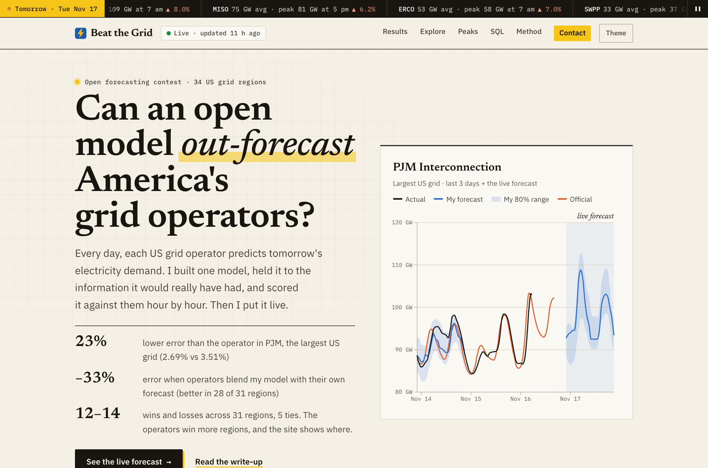
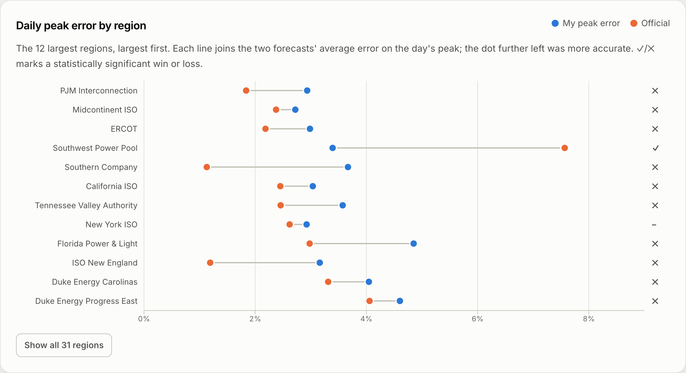
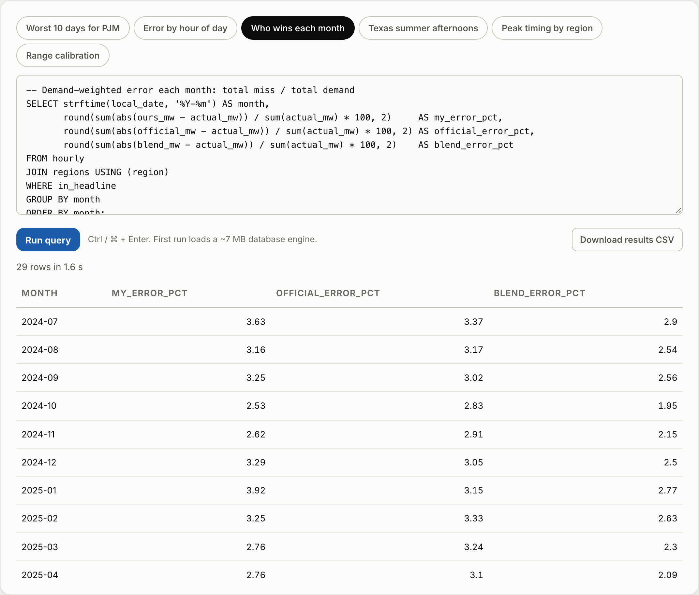
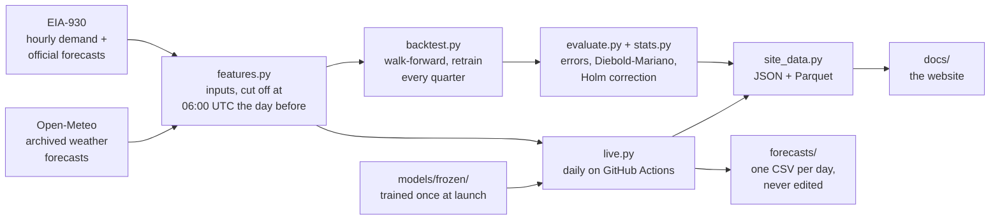

<h1> Beat the Grid</h1>

[](https://maxliston.github.io/beat-the-grid/)
[](https://github.com/MaxListon/beat-the-grid/actions/workflows/daily.yml)
[](https://github.com/MaxListon/beat-the-grid/actions/workflows/tests.yml)
[](requirements.txt)
[](LICENSE)

**Can one open model forecast tomorrow's electricity demand better than America's grid operators?**

### The project in 30 seconds

| | |
|---|---|
| **Problem** | Every US grid operator publishes a day-ahead forecast of hourly electricity demand, and those forecasts decide which power plants run. How good are they, and can an open model match them under fair rules? |
| **Approach** | One LightGBM model built only from public data (EIA demand, archived weather *forecasts*), allowed to see only what it would have known at 06:00 UTC the day before. Walk-forward backtest over 696,190 region-hours in 34 regions, judged with Diebold-Mariano tests and Holm correction. |
| **Result** | Lower error where most electricity is used (3.08% vs 3.68%, weighted by demand), but a split decision region by region (12 wins, 14 losses, 5 ties), and the operators are better at the daily peak. A blend of both cuts the operators' error by a third. |
| **What went wrong** | The first live forecast read stale demand data, so I voided it before its day began, kept it in the public log, and fixed the data feed. Then I added backup runs, pinned versions and a guard against issuing too early. |
| **What I learned** | A fair benchmark is most of the work: data cutoffs, significance tests and an honest live record matter more than model tweaks. And the most useful result wasn't "beat the operator" but "combine with the operator". |

Every day, each US balancing authority (the organization that keeps its region's grid in balance) publishes a day-ahead forecast of hourly electricity demand. This project builds one machine-learning model, gives it **only the information it would have had the morning before**, and scores it against those official forecasts across **34 grid regions**. They cover nearly all US electricity demand. Then it runs live: a new forecast is published every day and committed to this repo **before** the day it predicts.

**Website:** https://maxliston.github.io/beat-the-grid/ · **Write-up:** [WRITEUP.md](WRITEUP.md) · **Notebook:** [analysis.ipynb](notebooks/analysis.ipynb) · **Data dictionary:** [DATA.md](DATA.md) · **Every live forecast:** [forecasts/](forecasts/)

[](https://maxliston.github.io/beat-the-grid/)

| The peak contest | Query the data yourself (SQL in the browser) |
|---|---|
| [](https://maxliston.github.io/beat-the-grid/#peaks) | [](https://maxliston.github.io/beat-the-grid/#sql) |

**Skills shown:** Python (pandas, LightGBM), SQL (DuckDB), statistics (Diebold-Mariano tests, Holm correction, conformal prediction intervals), walk-forward backtesting, data engineering (EIA and weather APIs, Parquet), automation (GitHub Actions), data visualization (D3.js), and honest reporting of what didn't work.

<!-- RESULTS:START -->
## Results (backtest 2024-07-01 → 2026-11-14, 696,190 region-hours)

**My model beat the official day-ahead forecast in 12 of 31 regions** (Diebold-Mariano, Holm-corrected p < 0.05). 5 showed no significant difference and 14 went to the official forecast. My error was lower in 14 of 31.

| | Load-weighted hourly error (MAPE) |
|---|---|
| My model | **3.08%** |
| Official forecasts | 3.68% |
| Average of both | 2.78% |

80% prediction interval coverage: 79%.

**Model + operator.** Blending my forecast with the official one, with weights learned walk-forward per region and time of day, gives **2.45%** error and beats the official forecast alone in **28 of 31** regions (strict set: 2.32% vs 3.20%, 22 of 25). Annualised, that is 151 TWh of mis-forecast electricity for the official forecasts vs 102 TWh blended. At 2026 wholesale prices that energy is worth about $9.2 billion vs $6.4 billion a year (an illustration of scale, not a cost estimate).

**Strict check.** Limited to the 25 regions whose official forecast is clearly genuine (median error ≤ 5%, 86% of demand): 6 wins, 14 losses, 5 ties; load-weighted error 3.05% (mine) vs 3.20% (official) vs 2.56% (average of both).

**The peak contest.** On each day's highest hour the operators are clearly better: 19 losses, 10 wins, 2 ties for my model; peak error 3.26% (mine) vs 2.87% (official) vs 2.40% (blend).

**Takeaway.** The operators win more regions (their best forecasts are within 1–2%). My model wins PJM, the largest US grid, and California, and has the lower demand-weighted error. Averaging the two beats either one: they make different mistakes.

| Region | Avg GW | My MAPE | Official MAPE | Naive (last week) | p (Holm) | Result |
|---|---:|---:|---:|---:|---:|---|
| PJM Interconnection (PJM) | 96.9 | 2.69% | 3.51% | 8.64% | <0.001 | ✅ Win |
| Midcontinent ISO (MISO) | 76.6 | 2.42% | 2.42% | 7.41% | 1.000 | ➖ Tie |
| ERCOT (ERCO) | 56.9 | 2.65% | 2.07% | 8.29% | <0.001 | ❌ Loss |
| Southwest Power Pool (SWPP) | 34.6 | 2.85% | 7.11% | 8.57% | <0.001 | ✅ Win |
| Southern Company (SOCO) | 28.0 | 3.19% | 1.42% | 10.65% | <0.001 | ❌ Loss |
| California ISO (CISO) | 26.7 | 3.17% | 8.12% | 7.19% | <0.001 | ✅ Win |
| Tennessee Valley Authority (TVA) | 19.6 | 3.20% | 2.27% | 12.04% | <0.001 | ❌ Loss |
| New York ISO (NYIS) | 17.4 | 3.46% | 2.71% | 9.03% | <0.001 | ❌ Loss |
| Florida Power & Light (FPL) | 17.2 | 4.28% | 3.17% | 9.37% | <0.001 | ❌ Loss |
| ISO New England (ISNE) | 13.2 | 4.70% | 2.81% | 11.32% | <0.001 | ❌ Loss |
| Duke Energy Carolinas (DUK) | 12.7 | 3.64% | 3.04% | 12.38% | 0.015 | ❌ Loss |
| Duke Energy Progress East (CPLE) | 7.2 | 4.59% | 3.89% | 14.93% | <0.001 | ❌ Loss |
| Bonneville Power Administration (BPAT) | 7.0 | 2.16% | 1.87% | 5.62% | <0.001 | ❌ Loss |
| Duke Energy Florida (FPC) | 6.8 | 4.47% | 23.42% | 12.13% | <0.001 | ⚠️ Not scored (official data unreliable) |
| PacifiCorp East (PACE) | 6.1 | 2.99% | 5.04% | 6.14% | <0.001 | ✅ Win |
| Public Service Co. of Colorado (PSCO) | 5.3 | 4.87% | 12.28% | 9.17% | <0.001 | ⚠️ Not scored (official data unreliable) |
| NV Energy (NEVP) | 4.9 | 3.22% | 7.61% | 8.47% | <0.001 | ✅ Win |
| Arizona Public Service (AZPS) | 4.6 | 4.96% | 8.51% | 9.81% | <0.001 | ✅ Win |
| LG&E and KU (LGEE) | 4.4 | 4.03% | 7.71% | 12.81% | <0.001 | ✅ Win |
| Salt River Project (SRP) | 4.3 | 5.83% | 6.19% | 11.85% | 0.169 | ➖ Tie |
| Santee Cooper (SC) | 3.2 | 4.04% | 3.65% | 11.39% | 0.008 | ❌ Loss |
| Dominion Energy South Carolina (SCEG) | 2.9 | 4.56% | 4.89% | 12.86% | 0.161 | ➖ Tie |
| LA Dept. of Water & Power (LDWP) | 2.9 | 6.06% | 9.73% | 12.46% | <0.001 | ✅ Win |
| Puget Sound Energy (PSEI) | 2.8 | 2.74% | 27.72% | 6.84% | <0.001 | ⚠️ Not scored (official data unreliable) |
| Portland General Electric (PGE) | 2.7 | 2.55% | 1.42% | 6.78% | <0.001 | ❌ Loss |
| Tampa Electric (TEC) | 2.6 | 4.58% | 4.37% | 11.43% | 0.169 | ➖ Tie |
| Associated Electric Coop. (AECI) | 2.5 | 4.95% | 2.19% | 17.57% | <0.001 | ❌ Loss |
| PacifiCorp West (PACW) | 2.4 | 3.10% | 5.55% | 7.47% | <0.001 | ✅ Win |
| Florida Municipal Power Pool (FMPP) | 2.2 | 3.92% | 10.01% | 10.06% | <0.001 | ✅ Win |
| Idaho Power (IPCO) | 2.2 | 3.02% | 4.67% | 7.91% | <0.001 | ✅ Win |
| Balancing Authority of N. California (BANC) | 2.1 | 3.62% | 2.39% | 9.86% | <0.001 | ❌ Loss |
| Tucson Electric Power (TEPC) | 1.7 | 4.05% | 2.65% | 9.35% | <0.001 | ❌ Loss |
| Public Service Co. of New Mexico (PNM) | 1.7 | 3.00% | 6.21% | 6.45% | <0.001 | ✅ Win |
| JEA (JEA) | 1.6 | 4.68% | 4.67% | 12.54% | 1.000 | ➖ Tie |
<!-- RESULTS:END -->

---

## The rules (what makes the comparison fair)

| Rule | Why |
|---|---|
| Each forecast covers one **local calendar day** and is issued at **12:00 UTC the day before** (4 am Pacific, 7 am Eastern). | Matches the "day-ahead" timing of the official forecasts. |
| The model may only use demand reported up to **06:00 UTC** on the issue day. | Allows a 6-hour reporting lag. `tests/test_fairness.py` scrambles every later value and checks that the inputs don't change. |
| Weather inputs are archived **forecasts made ≥ 48 hours ahead**, never observed weather. | Using actual weather would be cheating; the model must forecast with the same uncertainty a forecaster faces. |
| Both forecasts are scored on **exactly the same hours**. | No region or hour is dropped for one side only. |
| Regions are chosen by **data coverage alone**, before scoring. | No cherry-picking easy wins. |
| Regions whose official forecast has a median error above 10% are **excluded from the headline**. | That size of error means the forecast doesn't match the reported demand (a reporting issue), so "beating" it would be meaningless. |

## Method

- **Data.** EIA-930 hourly demand and official day-ahead forecasts for every balancing authority, 2022 to today ([EIA Hourly Electric Grid Monitor](https://www.eia.gov/electricity/gridmonitor/)). Archived weather forecasts from the [Open-Meteo previous-runs API](https://open-meteo.com/en/docs/previous-runs-api), population-weighted across each region's largest cities.
- **Model.** One global LightGBM model across all regions. It predicts demand as a ratio to the past week's mean, so a 1.6 GW utility and the 94 GW PJM learn from each other. Inputs: recent demand (only what is visible at the cutoff), calendar and holidays, and temperature, humidity, cloud, wind and sunlight forecasts. Quantile models add an 80% prediction interval.
- **Backtest.** Walk-forward: retrain every quarter on the past only and forecast the next quarter, July 2024 → today. Training data for a test block ends two days before it starts.
- **Significance.** A Diebold-Mariano test on daily mean absolute percentage error, with Newey-West variance and the Harvey-Leybourne-Newbold correction, then Holm correction across all regions. A region is a **win** or **loss** only if the corrected p < 0.05; otherwise it is a **tie**.
- **Live.** `models/frozen/` was trained once at launch and is never retuned. `.github/workflows/daily.yml` runs at 12:00 UTC, with backup runs at 13:30 and 16:00 in case GitHub starts it late: it scores finished days, issues tomorrow's forecast to `forecasts/YYYY-MM-DD.csv` (never overwritten, never before 12:00 UTC), and rebuilds the site data. Package versions are pinned so the frozen model gives the same answer every day, and a failed run opens an issue.

## Run it

```bash
python3 -m venv ~/.venvs/beat-the-grid && source ~/.venvs/beat-the-grid/bin/activate
pip install -r requirements.txt
python -m grid.build      # download data, backtest, build site data, freeze the model (~3 h, mostly weather download)
python -m grid.live       # what the daily job runs
pytest                    # 38 tests: fairness, statistics, live-record rules
ruff check .              # Python lint
npm ci && npm run lint && npm run test:browser   # the website: ESLint, then 12 browser tests in real Chrome
```

All of these run on every push ([Tests workflow](.github/workflows/tests.yml)).

Raw downloads go to `~/.cache/beat-the-grid` (override with `GRID_CACHE`). On macOS, LightGBM needs `brew install libomp`.

Full write-up, including what didn't work: [WRITEUP.md](WRITEUP.md).

## Limitations

- Some operators may refresh their "day-ahead" forecast closer to real time. EIA doesn't publish when each forecast was made, and any later refresh would give them an edge here.
- Weather comes from up to three cities per region. Five per region was tested on the tuning window and didn't help (3.98% vs 4.00%).
- Archived humidity, cloud, wind and sunlight forecasts only start in February 2024, so scoring starts July 2024 (2022–mid-2024 is training only).
- Live forecasts use the latest weather forecast available at issue time (12–44 h ahead), slightly fresher than the ≥ 48 h forecasts used in the backtest. That makes live results, if anything, a little better than the backtest suggests.

## How it fits together



## Repo map

```
grid/            the pipeline (each file starts with a docstring saying what it does)
tests/           fairness (no peeking at the future), statistics, live-record rules
tests/e2e/       browser tests for the website (Node test runner + Puppeteer, real Chrome)
notebooks/       analysis.ipynb: the main findings, step by step in pandas
forecasts/       every live forecast (one CSV per target day) + live_scores.csv
models/frozen/   the model used for every live forecast
docs/            the website (GitHub Pages); docs/data/sql/ holds the Parquet tables
docs/js/         the site's JavaScript as ES modules (charts, explorer, game, live record, ...)
DATA.md          data dictionary: every table and column
WRITEUP.md       the full write-up, including what didn't work
```
